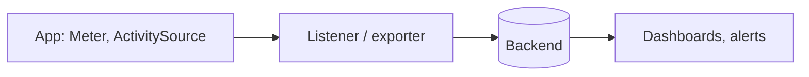

# Наблюдаемость и SLO: экспертная теория

🌐 **Русский** · [English](expert.en.md)

**Уровни:** [обзор](overview.ru.md) · [1. Базовая](basics.ru.md) · [2. Продвинутая](advanced.ru.md) · **3. Экспертная** · [4. Квиз](quiz.ru.md)

## Под капотом

`Meter` и `ActivitySource` — это точки публикации. Пока никто не подписан, они почти ничего не стоят; библиотека может инструментироваться, не зная, кто и куда будет экспортировать.



## Справочник

| Сэмплирование | Идея | Минус |
|---|---|---|
| Head | решение в начале трассы | редкие ошибки могут не попасть |
| Tail | решение после завершения | нужно буферизовать |
| По trace id | все сервисы решают одинаково | доля задана заранее |

| Набор метрик | Состав |
|---|---|
| RED (для сервисов) | rate, errors, duration |
| USE (для ресурсов) | utilization, saturation, errors |

| `tracestate` | |
|---|---|
| членов | не более 32 |
| один ключ | один раз |

## Подвохи

### StartActivity без слушателя

```csharp
var source = new ActivitySource("x");
var a = source.StartActivity("op");
a!.SetTag("k", 1);
```

Результат: `NullReferenceException`. Оператор `!` только заглушает компилятор. Код проходит там, где настроен экспортёр, и падает там, где его нет.

### Перцентиль из гистограммы — оценка

В тесте медленный сервер получает 10 значений по 1,5 с, а `QuantileUpperBound(0.99)` отвечает `2`: это граница корзины. После объединения с 990 быстрыми значениями p99 равен `0.1`, а p99,9 — `2`.

## Компромиссы и альтернативы

| Выбор | Плюс | Минус |
|---|---|---|
| Метрики | дёшево, долгое хранение | нет деталей запроса |
| Логи | детали | объём |
| Трассы | путь запроса | сэмплирование |
| Автоинструментирование | быстро | нет бизнес-смысла |

## Вопросы с собеседований

**1. Чем наблюдаемость отличается от мониторинга?**

<details><summary>Ответ</summary>

Мониторинг отвечает на заранее заданные вопросы, наблюдаемость позволяет задавать новые.

</details>

**2. Что такое спан и трасса?**

<details><summary>Ответ</summary>

Спан — одна операция; трасса — дерево связанных спанов запроса.

</details>

**3. Как передаётся контекст?**

<details><summary>Ответ</summary>

Заголовком `traceparent`; в сообщениях — свойствами сообщения.

</details>

**4. Почему нельзя тег `user_id`?**

<details><summary>Ответ</summary>

Взрыв числа временных рядов.

</details>

**5. Counter или Histogram для длительности?**

<details><summary>Ответ</summary>

Histogram.

</details>

**6. Почему нельзя усреднять p99?**

<details><summary>Ответ</summary>

Перцентиль не аддитивен; объединяют распределения.

</details>

**7. Что такое burn rate?**

<details><summary>Ответ</summary>

Скорость расхода бюджета ошибок относительно SLO.

</details>

**8. Чем head отличается от tail sampling?**

<details><summary>Ответ</summary>

Моментом решения: в начале или после завершения.

</details>

**9. Что вернёт `StartActivity` без слушателей?**

<details><summary>Ответ</summary>

`null`.

</details>

**10. Подвох: все дашборды зелёные, пользователи жалуются. Как так?**

<details><summary>Ответ</summary>

Измеряется не то: среднее вместо перцентилей, серверная сторона без сети и клиента, редкий сегмент тонет в общем.

</details>

## Связанные материалы

- [Продвинутая теория](advanced.ru.md)
- [Квиз](quiz.ru.md) и [упражнения](exercises.ru.md)

## Источники

- [W3C Trace Context](https://www.w3.org/TR/trace-context/)
- [.NET: инструментирование трассировки](https://learn.microsoft.com/dotnet/core/diagnostics/distributed-tracing-instrumentation-walkthroughs)
