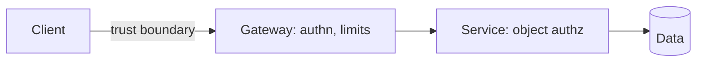

# Security architecture: expert

🌐 [Русский](expert.ru.md) · **English**

**Levels:** [overview](overview.en.md) · [1. Basics](basics.en.md) · [2. Advanced](advanced.en.md) · **3. Expert** · [4. Quiz](quiz.en.md)

## Under the hood

A slow hash makes brute force expensive; a salt prevents attacking many at once. A constant-time comparison does not reveal by delay how many bytes matched.



## Reference

| OWASP API Security Top 10 (2023) |
|---|
| API1 Broken Object Level Authorization |
| API2 Broken Authentication |
| API3 Broken Object Property Level Authorization |
| API4 Unrestricted Resource Consumption |
| API5 Broken Function Level Authorization |
| API6 Unrestricted Access to Sensitive Business Flows |
| API7 Server Side Request Forgery |
| API8 Security Misconfiguration |
| API9 Improper Inventory Management |
| API10 Unsafe Consumption of APIs |

## Gotchas

### Path.Combine throws the root away

```csharp
Console.WriteLine(Path.Combine("C:\\data", "C:\\Windows\\win.ini"));
Console.WriteLine(Path.Combine("data", "/etc/passwd"));
```

Result (Windows): `C:\Windows\win.ini` and `/etc/passwd`. A rooted second argument replaces the first.

### A prefix check without a separator

```csharp
Console.WriteLine(Path.GetFullPath("C:\\data\\..\\data-evil\\x").StartsWith(Path.GetFullPath("C:\\data")));
```

Result: `True`, although the file is outside `data`. Compare with the root including the trailing separator.

### Checking a URL by string prefix

```csharp
Console.WriteLine(new Uri("https://api.example.com@evil.test/").Host);
Console.WriteLine("https://api.example.com.evil.test/".StartsWith("https://api.example.com"));
```

Result: `evil.test` and `True`. Compare the whole parsed `Host`.

### A line break in a log

```csharp
var user = "bob\n2026-01-01 INFO admin logged in";
Console.WriteLine($"login failed for {user}");
```

Two lines are printed, the second looks like a real entry. Use structured logging and escaping.

## Trade-offs and alternatives

| Choice | Pro | Con |
|---|---|---|
| Stateless JWT | no session lookup | hard to revoke before expiry |
| Server sessions | instant revocation | shared storage |
| Checks in the gateway | one place | knows no objects |
| Checks in the service | precision | must not be forgotten anywhere |
| External identity provider | less own code | a dependency |

## Interview questions

**1. How does authentication differ from authorization?**

<details><summary>Answer</summary>

The first establishes identity, the second decides what it may do.

</details>

**2. What is BOLA?**

<details><summary>Answer</summary>

Access to someone else's object by substituting an identifier, due to a missing object permission check.

</details>

**3. Do GUIDs instead of numbers help?**

<details><summary>Answer</summary>

They make guessing harder but do not replace authorization.

</details>

**4. Why a salt?**

<details><summary>Answer</summary>

Equal passwords give different hashes, and precomputed tables are useless.

</details>

**5. A hash or encryption for passwords?**

<details><summary>Answer</summary>

A hash: the password never needs to be recovered.

</details>

**6. Why a constant-time comparison?**

<details><summary>Answer</summary>

Against timing attacks.

</details>

**7. How do you protect a signed request from replay?**

<details><summary>Answer</summary>

A timestamp and a one-time nonce covered by the signature.

</details>

**8. What is SSRF?**

<details><summary>Answer</summary>

The server is made to send a request where the client may not.

</details>

**9. What is the principle of least privilege?**

<details><summary>Answer</summary>

Grant only the rights needed for the task.

</details>

**10. Trick question: a service is on the internal network. Does it need authorization?**

<details><summary>Answer</summary>

Yes: the network may be breached, and a request may come from a compromised service.

</details>

## Related materials

- [Advanced theory](advanced.en.md)
- [Quiz](quiz.en.md) and [exercises](exercises.en.md)

## Sources

- [OWASP API Security Top 10, 2023](https://owasp.org/API-Security/editions/2023/en/0x11-t10/)
- [OWASP: Password Storage](https://cheatsheetseries.owasp.org/cheatsheets/Password_Storage_Cheat_Sheet.html)
