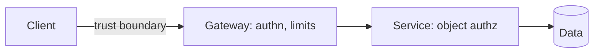

# Security architecture: expert

🌐 [Русский](expert.ru.md) · **English**

**Levels:** [overview](overview.en.md) · [1. Basics](basics.en.md) · [2. Advanced](advanced.en.md) · **3. Expert** · [4. Quiz](quiz.en.md)

## Under the hood

A slow hash makes brute force expensive; a salt prevents attacking many at once. A constant-time comparison does not reveal by delay how many bytes matched.



### OAuth 2.0 and OpenID Connect

OAuth 2.0 grants access, OpenID Connect adds identity on top: the `openid` scope and the ID Token, a signed JWT with the required `iss`, `sub`, `aud`, `exp`, `iat`. For signing users in, the authorization code flow with PKCE is used: the client invents a secret `code_verifier`, sends its hash, and presents the original when exchanging the code.

```csharp
public static string Challenge(string verifier) =>
    Base64Url.EncodeToString(SHA256.HashData(Encoding.ASCII.GetBytes(verifier)));
```

The code is checked against the example in RFC 7636. The verifier is 43 to 128 characters long, the method is `S256`. File: [Ex04_Pkce.cs](code/Examples/Ex04_Pkce.cs). You do not implement the protocol yourself: use a proven library and provider.

### mTLS and rotation

With mTLS both sides present certificates. To change the root certificate without downtime, both the old and the new one are trusted for a while.

```csharp
chain.ChainPolicy.TrustMode = X509ChainTrustMode.CustomRootTrust; // not the machine store
chain.ChainPolicy.CustomTrustStore.AddRange(trustedRoots);
```

The order: add the new root to all verifiers, reissue certificates, remove the old root. File: [Ex06_CertificateRotation.cs](code/Examples/Ex06_CertificateRotation.cs); revocation is switched off in the example — never do that in production. In ASP.NET Core behind a proxy the client certificate reaches the application only if the proxy forwards it (for example in a header) and certificate forwarding is configured; such a header may be trusted only from the proxy itself.

### Secrets and keys

Secrets are kept in a dedicated store, issued by service identity, rotated and access is audited. Envelope encryption: every object is encrypted with its own data key, which in turn is encrypted with a key from a KMS. Rotation re-encrypts only the small key.

```csharp
public Envelope Rewrap(Envelope e) =>
    e with { KeyVersion = Current, WrappedKey = Seal(_keys[^1], Open(_keys[e.KeyVersion - 1], e.WrappedKey)) };
```

File: [Ex05_Envelope.cs](code/Examples/Ex05_Envelope.cs). An old key version is removed only when everything has been re-wrapped.

### Tenant isolation

The tenant identifier is taken from a verified token, not from the request, and is included in every key, cache and queue.

```csharp
public Invoice? Find(int number) => table.GetValueOrDefault((tenantId, number));
```

| Model | Isolation | Price |
|---|---|---|
| A database per tenant | strong | expensive to operate |
| A schema per tenant | medium | migrations across all schemas |
| Shared tables with `tenant_id` | depends on code and database policies | cheap |

### The supply chain

An SBOM lists what an artifact consists of, a signature and provenance say who built it and from what. SLSA describes build levels: L1 — provenance exists, L2 — builds on a hosted platform, L3 — hardened isolation of builds. In .NET `NuGetAudit` is on by default and reports vulnerable packages; for projects targeting net10.0 or newer, transitive dependencies are checked too.

## Reference

| OWASP API Security Top 10 (2023) |
|---|
| API1 Broken Object Level Authorization |
| API2 Broken Authentication |
| API3 Broken Object Property Level Authorization |
| API4 Unrestricted Resource Consumption |
| API5 Broken Function Level Authorization |
| API6 Unrestricted Access to Sensitive Business Flows |
| API7 Server Side Request Forgery |
| API8 Security Misconfiguration |
| API9 Improper Inventory Management |
| API10 Unsafe Consumption of APIs |

| OAuth flow | Status per RFC 9700 |
|---|---|
| Authorization code + PKCE | public clients must use PKCE, others are advised to |
| Implicit | should not be used |
| Resource owner password | must not be used |
| Client credentials | service to service without a user |

Redirect URIs are compared by exact string match (except the localhost port of native applications).

| Token | Meant for |
|---|---|
| ID Token | the client: who signed in |
| Access token | the API: what is allowed |
| Refresh token | the authorization server: to get a new access token |

## Gotchas

### Path.Combine throws the root away

```csharp
Console.WriteLine(Path.Combine("C:\\data", "C:\\Windows\\win.ini"));
Console.WriteLine(Path.Combine("data", "/etc/passwd"));
```

Result (Windows): `C:\Windows\win.ini` and `/etc/passwd`. A rooted second argument replaces the first.

### A prefix check without a separator

```csharp
Console.WriteLine(Path.GetFullPath("C:\\data\\..\\data-evil\\x").StartsWith(Path.GetFullPath("C:\\data")));
```

Result: `True`, although the file is outside `data`. Compare with the root including the trailing separator.

### Checking a URL by string prefix

```csharp
Console.WriteLine(new Uri("https://api.example.com@evil.test/").Host);
Console.WriteLine("https://api.example.com.evil.test/".StartsWith("https://api.example.com"));
```

Result: `evil.test` and `True`. Compare the whole parsed `Host`.

### A line break in a log

```csharp
var user = "bob\n2026-01-01 INFO admin logged in";
Console.WriteLine($"login failed for {user}");
```

Two lines are printed, the second looks like a real entry. Use structured logging and escaping.

### A shared cache without the tenant in the key

The repository isolates the table, but a cache keyed `invoice:1` will serve someone else's invoice. The tenant must be part of the cache key, the file name and the queue message.

### An ID Token instead of an access token

An ID Token is addressed to the client (`aud` is its `client_id`). An API accepting it as a pass is checking the wrong thing.

## Trade-offs and alternatives

| Choice | Pro | Con |
|---|---|---|
| Stateless JWT | no session lookup | hard to revoke before expiry |
| Server sessions | instant revocation | shared storage |
| Checks in the gateway | one place | knows no objects |
| Checks in the service | precision | must not be forgotten anywhere |
| External identity provider | less own code | a dependency |

## Interview questions

**1. How does authentication differ from authorization?**

<details><summary>Answer</summary>

The first establishes identity, the second decides what it may do.

</details>

**2. What is BOLA?**

<details><summary>Answer</summary>

Access to someone else's object by substituting an identifier, due to a missing object permission check.

</details>

**3. Do GUIDs instead of numbers help?**

<details><summary>Answer</summary>

They make guessing harder but do not replace authorization.

</details>

**4. Why a salt?**

<details><summary>Answer</summary>

Equal passwords give different hashes, and precomputed tables are useless.

</details>

**5. A hash or encryption for passwords?**

<details><summary>Answer</summary>

A hash: the password never needs to be recovered.

</details>

**6. Why a constant-time comparison?**

<details><summary>Answer</summary>

Against timing attacks.

</details>

**7. How do you protect a signed request from replay?**

<details><summary>Answer</summary>

A timestamp and a one-time nonce covered by the signature.

</details>

**8. What is SSRF?**

<details><summary>Answer</summary>

The server is made to send a request where the client may not.

</details>

**9. What is the principle of least privilege?**

<details><summary>Answer</summary>

Grant only the rights needed for the task.

</details>

**10. Trick question: a service is on the internal network. Does it need authorization?**

<details><summary>Answer</summary>

Yes: the network may be breached, and a request may come from a compromised service.

</details>

**11. Why PKCE?**

<details><summary>Answer</summary>

An intercepted authorization code is useless without the `code_verifier`.

</details>

**12. What does OpenID Connect add to OAuth 2.0?**

<details><summary>Answer</summary>

An identity layer with the ID Token.

</details>

**13. How do you change a root certificate without downtime?**

<details><summary>Answer</summary>

Trust both first, then reissue, then remove the old one.

</details>

**14. What is envelope encryption?**

<details><summary>Answer</summary>

Data is encrypted with a data key, and that key with a key from a KMS.

</details>

**15. Trick question: the image is signed. Is it secure then?**

<details><summary>Answer</summary>

No: a signature speaks of origin and integrity, not of the absence of vulnerabilities.

</details>

## Related materials

- [Advanced theory](advanced.en.md)
- [Quiz](quiz.en.md) and [exercises](exercises.en.md)

## Sources

- [OWASP API Security Top 10, 2023](https://owasp.org/API-Security/editions/2023/en/0x11-t10/)
- [OWASP: Password Storage](https://cheatsheetseries.owasp.org/cheatsheets/Password_Storage_Cheat_Sheet.html)
- [RFC 7636: PKCE](https://www.rfc-editor.org/rfc/rfc7636)
- [RFC 9700: OAuth 2.0 Security Best Current Practice](https://www.rfc-editor.org/rfc/rfc9700)
- [OpenID Connect Core](https://openid.net/specs/openid-connect-core-1_0.html)
- [ASP.NET Core: certificate authentication](https://learn.microsoft.com/aspnet/core/security/authentication/certauth)
- [NuGet: auditing packages](https://learn.microsoft.com/nuget/concepts/auditing-packages)
- [SLSA: build track](https://slsa.dev/spec/v1.2/build-track-basics)
