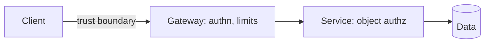

# Безопасность архитектуры: экспертная теория

🌐 **Русский** · [English](expert.en.md)

**Уровни:** [обзор](overview.ru.md) · [1. Базовая](basics.ru.md) · [2. Продвинутая](advanced.ru.md) · **3. Экспертная** · [4. Квиз](quiz.ru.md)

## Под капотом

Медленный хэш делает перебор дорогим; соль не даёт подобрать сразу многих. Сравнение за постоянное время не выдаёт по задержке, сколько байт совпало.



### OAuth 2.0 и OpenID Connect

OAuth 2.0 выдаёт доступ, OpenID Connect добавляет поверх него личность: scope `openid` и ID Token — подписанный JWT с обязательными `iss`, `sub`, `aud`, `exp`, `iat`. Для входа пользователей используют authorization code flow с PKCE: клиент придумывает секрет `code_verifier`, отправляет его хэш, а при обмене кода предъявляет оригинал.

```csharp
public static string Challenge(string verifier) =>
    Base64Url.EncodeToString(SHA256.HashData(Encoding.ASCII.GetBytes(verifier)));
```

Код проверен на примере из RFC 7636. Длина verifier — от 43 до 128 символов, метод — `S256`. Файл: [Ex04_Pkce.cs](code/Examples/Ex04_Pkce.cs). Протокол не реализуют сами: берут проверенную библиотеку и провайдера.

### mTLS и ротация

При mTLS обе стороны предъявляют сертификаты. Чтобы сменить корневой сертификат без простоя, какое-то время доверяют и старому, и новому.

```csharp
chain.ChainPolicy.TrustMode = X509ChainTrustMode.CustomRootTrust; // not the machine store
chain.ChainPolicy.CustomTrustStore.AddRange(trustedRoots);
```

Порядок: добавить новый корень всем проверяющим, перевыпустить сертификаты, убрать старый корень. Файл: [Ex06_CertificateRotation.cs](code/Examples/Ex06_CertificateRotation.cs); отзыв в примере выключен — в production так делать нельзя. В ASP.NET Core за прокси сертификат клиента доходит до приложения, только если прокси передаёт его (например, заголовком) и настроен certificate forwarding; доверять такому заголовку можно только от самого прокси.

### Секреты и ключи

Секреты хранят в специальном хранилище, выдают по идентичности сервиса, ротируют и журналируют доступ. Envelope encryption: каждый объект шифруется своим ключом данных, а тот — ключом из KMS. Ротация перешифровывает только маленький ключ.

```csharp
public Envelope Rewrap(Envelope e) =>
    e with { KeyVersion = Current, WrappedKey = Seal(_keys[^1], Open(_keys[e.KeyVersion - 1], e.WrappedKey)) };
```

Файл: [Ex05_Envelope.cs](code/Examples/Ex05_Envelope.cs). Старую версию ключа удаляют, только когда перешифровано всё.

### Изоляция арендаторов

Идентификатор арендатора берут из проверенного токена, а не из запроса, и включают в каждый ключ, кэш и очередь.

```csharp
public Invoice? Find(int number) => table.GetValueOrDefault((tenantId, number));
```

| Модель | Изоляция | Цена |
|---|---|---|
| База на арендатора | сильная | дорого сопровождать |
| Схема на арендатора | средняя | миграции по всем схемам |
| Общие таблицы с `tenant_id` | зависит от кода и политик базы | дёшево |

### Цепочка поставок

SBOM перечисляет состав артефакта, подпись и provenance говорят, кто и из чего его собрал. SLSA описывает уровни сборки: L1 — provenance существует, L2 — сборка на размещённой платформе, L3 — усиленная изоляция сборок. В .NET `NuGetAudit` по умолчанию включён и сообщает об уязвимых пакетах; для проектов под net10.0 и новее проверяются и транзитивные зависимости.

## Справочник

| OWASP API Security Top 10 (2023) |
|---|
| API1 Broken Object Level Authorization |
| API2 Broken Authentication |
| API3 Broken Object Property Level Authorization |
| API4 Unrestricted Resource Consumption |
| API5 Broken Function Level Authorization |
| API6 Unrestricted Access to Sensitive Business Flows |
| API7 Server Side Request Forgery |
| API8 Security Misconfiguration |
| API9 Improper Inventory Management |
| API10 Unsafe Consumption of APIs |

| Поток OAuth | Статус по RFC 9700 |
|---|---|
| Authorization code + PKCE | публичные клиенты обязаны использовать PKCE, остальным рекомендуется |
| Implicit | не следует использовать |
| Resource owner password | использовать нельзя |
| Client credentials | сервис–сервис без пользователя |

Redirect URI сравнивают точным совпадением строк (исключение — порт localhost у нативных приложений).

| Токен | Кому предназначен |
|---|---|
| ID Token | клиенту: кто вошёл |
| Access token | API: что разрешено |
| Refresh token | серверу авторизации: получить новый access token |

## Подвохи

### Path.Combine отбрасывает корень

```csharp
Console.WriteLine(Path.Combine("C:\\data", "C:\\Windows\\win.ini"));
Console.WriteLine(Path.Combine("data", "/etc/passwd"));
```

Результат (Windows): `C:\Windows\win.ini` и `/etc/passwd`. Абсолютный второй аргумент заменяет первый.

### Проверка префикса без разделителя

```csharp
Console.WriteLine(Path.GetFullPath("C:\\data\\..\\data-evil\\x").StartsWith(Path.GetFullPath("C:\\data")));
```

Результат: `True`, хотя файл вне `data`. Корень сравнивают вместе с завершающим разделителем.

### Проверка URL по префиксу строки

```csharp
Console.WriteLine(new Uri("https://api.example.com@evil.test/").Host);
Console.WriteLine("https://api.example.com.evil.test/".StartsWith("https://api.example.com"));
```

Результат: `evil.test` и `True`. Сравнивать нужно разобранный `Host` целиком.

### Перевод строки в логе

```csharp
var user = "bob\n2026-01-01 INFO admin logged in";
Console.WriteLine($"login failed for {user}");
```

Выводятся две строки, вторая выглядит как настоящая запись. Используйте структурированное логирование и экранирование.

### Общий кэш без арендатора в ключе

Репозиторий изолирует таблицу, но кэш с ключом `invoice:1` отдаст чужой счёт. Арендатор должен входить в ключ кэша, имя файла и сообщение в очереди.

### ID Token вместо access token

ID Token адресован клиенту (`aud` — его `client_id`). API, принимающее его как пропуск, проверяет не то.

## Компромиссы и альтернативы

| Выбор | Плюс | Минус |
|---|---|---|
| JWT без состояния | не нужен поиск сессии | трудно отозвать до истечения |
| Серверные сессии | мгновенный отзыв | общее хранилище |
| Проверки в шлюзе | одно место | не знает объектов |
| Проверки в сервисе | точность | нужно не забыть везде |
| Внешний провайдер входа | меньше своего кода | зависимость |

## Вопросы с собеседований

**1. Чем аутентификация отличается от авторизации?**

<details><summary>Ответ</summary>

Первая устанавливает личность, вторая решает, что ей можно.

</details>

**2. Что такое BOLA?**

<details><summary>Ответ</summary>

Доступ к чужому объекту подменой идентификатора из-за отсутствия проверки прав на объект.

</details>

**3. Помогают ли GUID вместо чисел?**

<details><summary>Ответ</summary>

Затрудняют угадывание, но не заменяют авторизацию.

</details>

**4. Зачем соль?**

<details><summary>Ответ</summary>

Одинаковые пароли дают разные хэши, заранее вычисленные таблицы бесполезны.

</details>

**5. Хэш или шифрование для паролей?**

<details><summary>Ответ</summary>

Хэш: восстанавливать пароль не нужно.

</details>

**6. Зачем сравнение за постоянное время?**

<details><summary>Ответ</summary>

Против атак по времени ответа.

</details>

**7. Как защититься от повтора подписанного запроса?**

<details><summary>Ответ</summary>

Метка времени и одноразовый nonce, входящие в подпись.

</details>

**8. Что такое SSRF?**

<details><summary>Ответ</summary>

Сервер вынуждают выполнить запрос туда, куда клиенту нельзя.

</details>

**9. Что такое принцип минимальных привилегий?**

<details><summary>Ответ</summary>

Давать только права, необходимые для задачи.

</details>

**10. Подвох: сервис во внутренней сети. Нужна ли ему авторизация?**

<details><summary>Ответ</summary>

Да: сеть могут пробить, а запрос может исходить от скомпрометированного сервиса.

</details>

**11. Зачем PKCE?**

<details><summary>Ответ</summary>

Перехваченный код авторизации бесполезен без `code_verifier`.

</details>

**12. Что добавляет OpenID Connect к OAuth 2.0?**

<details><summary>Ответ</summary>

Слой идентификации с ID Token.

</details>

**13. Как сменить корневой сертификат без простоя?**

<details><summary>Ответ</summary>

Сначала доверять обоим, потом перевыпустить, затем убрать старый.

</details>

**14. Что такое envelope encryption?**

<details><summary>Ответ</summary>

Данные шифруются ключом данных, а он — ключом из KMS.

</details>

**15. Подвох: образ подписан. Значит, он безопасен?**

<details><summary>Ответ</summary>

Нет: подпись говорит о происхождении и целостности, а не об отсутствии уязвимостей.

</details>

## Связанные материалы

- [Продвинутая теория](advanced.ru.md)
- [Квиз](quiz.ru.md) и [упражнения](exercises.ru.md)

## Источники

- [OWASP API Security Top 10, 2023](https://owasp.org/API-Security/editions/2023/en/0x11-t10/)
- [OWASP: Password Storage](https://cheatsheetseries.owasp.org/cheatsheets/Password_Storage_Cheat_Sheet.html)
- [RFC 7636: PKCE](https://www.rfc-editor.org/rfc/rfc7636)
- [RFC 9700: OAuth 2.0 Security Best Current Practice](https://www.rfc-editor.org/rfc/rfc9700)
- [OpenID Connect Core](https://openid.net/specs/openid-connect-core-1_0.html)
- [ASP.NET Core: certificate authentication](https://learn.microsoft.com/aspnet/core/security/authentication/certauth)
- [NuGet: аудит пакетов](https://learn.microsoft.com/nuget/concepts/auditing-packages)
- [SLSA: build track](https://slsa.dev/spec/v1.2/build-track-basics)
