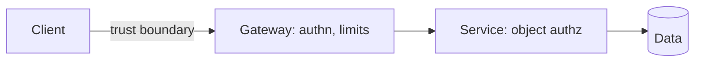

# Безопасность архитектуры: экспертная теория

🌐 **Русский** · [English](expert.en.md)

**Уровни:** [обзор](overview.ru.md) · [1. Базовая](basics.ru.md) · [2. Продвинутая](advanced.ru.md) · **3. Экспертная** · [4. Квиз](quiz.ru.md)

## Под капотом

Медленный хэш делает перебор дорогим; соль не даёт подобрать сразу многих. Сравнение за постоянное время не выдаёт по задержке, сколько байт совпало.



## Справочник

| OWASP API Security Top 10 (2023) |
|---|
| API1 Broken Object Level Authorization |
| API2 Broken Authentication |
| API3 Broken Object Property Level Authorization |
| API4 Unrestricted Resource Consumption |
| API5 Broken Function Level Authorization |
| API6 Unrestricted Access to Sensitive Business Flows |
| API7 Server Side Request Forgery |
| API8 Security Misconfiguration |
| API9 Improper Inventory Management |
| API10 Unsafe Consumption of APIs |

## Подвохи

### Path.Combine отбрасывает корень

```csharp
Console.WriteLine(Path.Combine("C:\\data", "C:\\Windows\\win.ini"));
Console.WriteLine(Path.Combine("data", "/etc/passwd"));
```

Результат (Windows): `C:\Windows\win.ini` и `/etc/passwd`. Абсолютный второй аргумент заменяет первый.

### Проверка префикса без разделителя

```csharp
Console.WriteLine(Path.GetFullPath("C:\\data\\..\\data-evil\\x").StartsWith(Path.GetFullPath("C:\\data")));
```

Результат: `True`, хотя файл вне `data`. Корень сравнивают вместе с завершающим разделителем.

### Проверка URL по префиксу строки

```csharp
Console.WriteLine(new Uri("https://api.example.com@evil.test/").Host);
Console.WriteLine("https://api.example.com.evil.test/".StartsWith("https://api.example.com"));
```

Результат: `evil.test` и `True`. Сравнивать нужно разобранный `Host` целиком.

### Перевод строки в логе

```csharp
var user = "bob\n2026-01-01 INFO admin logged in";
Console.WriteLine($"login failed for {user}");
```

Выводятся две строки, вторая выглядит как настоящая запись. Используйте структурированное логирование и экранирование.

## Компромиссы и альтернативы

| Выбор | Плюс | Минус |
|---|---|---|
| JWT без состояния | не нужен поиск сессии | трудно отозвать до истечения |
| Серверные сессии | мгновенный отзыв | общее хранилище |
| Проверки в шлюзе | одно место | не знает объектов |
| Проверки в сервисе | точность | нужно не забыть везде |
| Внешний провайдер входа | меньше своего кода | зависимость |

## Вопросы с собеседований

**1. Чем аутентификация отличается от авторизации?**

<details><summary>Ответ</summary>

Первая устанавливает личность, вторая решает, что ей можно.

</details>

**2. Что такое BOLA?**

<details><summary>Ответ</summary>

Доступ к чужому объекту подменой идентификатора из-за отсутствия проверки прав на объект.

</details>

**3. Помогают ли GUID вместо чисел?**

<details><summary>Ответ</summary>

Затрудняют угадывание, но не заменяют авторизацию.

</details>

**4. Зачем соль?**

<details><summary>Ответ</summary>

Одинаковые пароли дают разные хэши, заранее вычисленные таблицы бесполезны.

</details>

**5. Хэш или шифрование для паролей?**

<details><summary>Ответ</summary>

Хэш: восстанавливать пароль не нужно.

</details>

**6. Зачем сравнение за постоянное время?**

<details><summary>Ответ</summary>

Против атак по времени ответа.

</details>

**7. Как защититься от повтора подписанного запроса?**

<details><summary>Ответ</summary>

Метка времени и одноразовый nonce, входящие в подпись.

</details>

**8. Что такое SSRF?**

<details><summary>Ответ</summary>

Сервер вынуждают выполнить запрос туда, куда клиенту нельзя.

</details>

**9. Что такое принцип минимальных привилегий?**

<details><summary>Ответ</summary>

Давать только права, необходимые для задачи.

</details>

**10. Подвох: сервис во внутренней сети. Нужна ли ему авторизация?**

<details><summary>Ответ</summary>

Да: сеть могут пробить, а запрос может исходить от скомпрометированного сервиса.

</details>

## Связанные материалы

- [Продвинутая теория](advanced.ru.md)
- [Квиз](quiz.ru.md) и [упражнения](exercises.ru.md)

## Источники

- [OWASP API Security Top 10, 2023](https://owasp.org/API-Security/editions/2023/en/0x11-t10/)
- [OWASP: Password Storage](https://cheatsheetseries.owasp.org/cheatsheets/Password_Storage_Cheat_Sheet.html)
