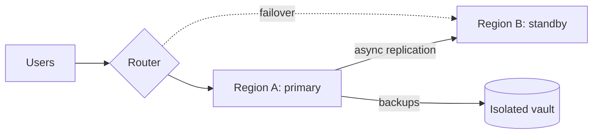

# Multi-region and recovery: expert

🌐 [Русский](expert.ru.md) · **English**

**Levels:** [overview](overview.en.md) · [1. Basics](basics.en.md) · [2. Advanced](advanced.en.md) · **3. Expert** · [4. Quiz](quiz.en.md)

## Under the hood

Physics sets a lower bound on latency between regions, so synchronous replication over long distances makes every write more expensive. Hence the usual choice: asynchronous replication and a non-zero RPO.



## Reference

| Scenario | Helps | Does not help |
|---|---|---|
| Zone failure | several zones | — |
| Region failure | a second region | zones only |
| Accidental delete | backups, point-in-time recovery | a replica |
| Data corrupted by the application | point-in-time recovery | active-active |
| Compromised account | isolated backups | backups next to the data |
| A bad release | rollback, gradual rollout | a second region with the same release |

| Merge in active-active | What happens to concurrent changes |
|---|---|
| LWW | one is lost |
| OR-Set | an add beats a removal that had not seen it |
| Application | by a business rule |

## Gotchas

### Time without an offset

```csharp
var t = new DateTime(2026, 3, 29, 12, 0, 0, DateTimeKind.Unspecified);
Console.WriteLine(JsonSerializer.Serialize(t));
Console.WriteLine(JsonSerializer.Serialize(DateTime.SpecifyKind(t, DateTimeKind.Utc)));
```

Result: `"2026-03-29T12:00:00"` and `"2026-03-29T12:00:00Z"`. Each region may read the first string its own way. Store UTC and use `DateTimeOffset`.

### An OR-Set grows

Removed tags in the example are kept forever: to drop them you need to know that all replicas have seen them.

### A fast LWW still loses data

In the test, merging baskets with stamps 1 and 2 took the second one whole: the `pen` added in the first vanished without an error.

## Trade-offs and alternatives

| Choice | Pro | Con |
|---|---|---|
| One zone | cheap | a zone failure is downtime |
| Several zones | protects against most failures | not against a region failure |
| Active and standby region | a clear model | the standby idles and rots |
| Active-active | short recovery, close to users | conflicts and complexity |
| Manual failover | fewer false alarms | longer RTO |

## Interview questions

**1. How does RPO differ from RTO?**

<details><summary>Answer</summary>

The first is how much data, in time, may be lost; the second how long recovery may take.

</details>

**2. What RPO does asynchronous replication give?**

<details><summary>Answer</summary>

Not zero: roughly the lag at the moment of failure.

</details>

**3. Pilot light and warm standby?**

<details><summary>Answer</summary>

In the first the applications are off, in the second a scaled down copy can already serve.

</details>

**4. Why backups if there are three regions?**

<details><summary>Answer</summary>

Corruption and deletion are replicated to all regions.

</details>

**5. What is dangerous about automatic failover?**

<details><summary>Answer</summary>

False switches, flapping, two leaders.

</details>

**6. What is a home region?**

<details><summary>Answer</summary>

The region accepting all writes of a given user: no conflicts arise.

</details>

**7. How do you check that recovery works?**

<details><summary>Answer</summary>

Perform it regularly and measure time and data completeness.

</details>

**8. What besides the database slows a failover down?**

<details><summary>Answer</summary>

DNS and caches, quotas, secrets, external dependencies, getting the decision approved.

</details>

**9. How do you handle data residency requirements?**

<details><summary>Answer</summary>

The recovery region and backups must be in a permitted jurisdiction.

</details>

**10. Trick question: does active-active give RPO = 0?**

<details><summary>Answer</summary>

Not if replication is asynchronous; and on data corruption you restore from a backup, that is, with losses.

</details>

## Related materials

- [Advanced theory](advanced.en.md)
- [Quiz](quiz.en.md) and [exercises](exercises.en.md)

## Sources

- [AWS: disaster recovery options](https://docs.aws.amazon.com/whitepapers/latest/disaster-recovery-workloads-on-aws/disaster-recovery-options-in-the-cloud.html)
