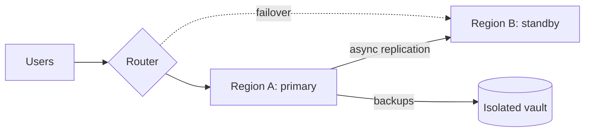

# Несколько регионов и восстановление: экспертная теория

🌐 **Русский** · [English](expert.en.md)

**Уровни:** [обзор](overview.ru.md) · [1. Базовая](basics.ru.md) · [2. Продвинутая](advanced.ru.md) · **3. Экспертная** · [4. Квиз](quiz.ru.md)

## Под капотом

Физика задаёт нижнюю границу задержки между регионами, поэтому синхронная репликация на большие расстояния удорожает каждую запись. Отсюда обычный выбор: асинхронная репликация и ненулевой RPO.



### Глобальные базы и уровни согласованности

Azure Cosmos DB предлагает пять уровней, от сильного к слабому: Strong, Bounded staleness, Session, Consistent prefix, Eventual. Учётная запись с несколькими пишущими регионами не может использовать Strong. Выбор уровня — это тот же компромисс [PACELC](../07-consistency-and-cap/advanced.ru.md), оформленный как настройка.

### Сколько занимает переключение по DNS

Время складывается не только из TTL: сначала несколько неудачных проверок, затем изменение записи, и лишь потом истекают кэши.

```csharp
public static TimeSpan WorstCase(TimeSpan probeInterval, int failuresNeeded, TimeSpan recordUpdate, TimeSpan ttl) =>
    probeInterval * failuresNeeded + recordUpdate + ttl;
```

Проверки раз в 30 с, три неудачи, 30 с на обновление и TTL 60 с дают 180 секунд. Клиенты, не соблюдающие TTL, переключатся ещё позже. Anycast не зависит от кэшей DNS: меняется маршрут. Файл: [Ex04_Drill.cs](code/Examples/Ex04_Drill.cs).

### Неизменяемые копии

Копию, которую нельзя удалить до срока, не уничтожит и захваченная учётная запись. В S3 Object Lock режим compliance не позволяет удалить или перезаписать версию никому, включая root, и срок нельзя сократить; режим governance разрешает обход пользователям со специальным правом. Срок можно продлевать в обоих режимах.

```csharp
public bool TryDelete(string name) =>
    _objects.TryGetValue(name, out var o) && clock.GetUtcNow() >= o.RetainUntil && _objects.Remove(name);
```

Это модель идеи, а не API хранилища.

### Учения (game days)

Заранее назначают сценарий, цели и условия остановки, выполняют восстановление по инструкции и сравнивают факт с целями.

```csharp
TimeSpan recovery = serviceRestored - failure, loss = failure - newestRecoveredWrite;
return new(recovery, loss, recovery <= rto, loss <= rpo);
```

Восстановление за 45 минут при цели 30 — результат учений, который нужно записать и исправить.

## Справочник

| Сценарий | Помогает | Не помогает |
|---|---|---|
| Отказ зоны | несколько зон | — |
| Отказ региона | второй регион | только зоны |
| Случайное удаление | копии, восстановление на момент | реплика |
| Порча данных приложением | восстановление на момент | active-active |
| Взлом учётной записи | изолированные копии | копии рядом с данными |
| Плохой релиз | откат, постепенная выкатка | второй регион с тем же релизом |

| Слияние в active-active | Что с одновременными изменениями |
|---|---|
| LWW | одно теряется |
| OR-Set | добавление побеждает невидевшее его удаление |
| Приложение | по бизнес-правилу |

| Шаг учений | Что проверяется |
|---|---|
| Восстановление из копии | копии читаются и полны |
| Переключение трафика | маршрутизация и кэши |
| Работа без основного региона | скрытые зависимости |
| Failback | перенос накопившихся данных |

| Режим S3 Object Lock | Кто может удалить до срока |
|---|---|
| Governance | пользователи со специальным разрешением |
| Compliance | никто |

## Подвохи

### Время без смещения

```csharp
var t = new DateTime(2026, 3, 29, 12, 0, 0, DateTimeKind.Unspecified);
Console.WriteLine(JsonSerializer.Serialize(t));
Console.WriteLine(JsonSerializer.Serialize(DateTime.SpecifyKind(t, DateTimeKind.Utc)));
```

Результат: `"2026-03-29T12:00:00"` и `"2026-03-29T12:00:00Z"`. Первую строку каждый регион может понять по-своему. Храните UTC и используйте `DateTimeOffset`.

### OR-Set растёт

Удалённые метки в примере хранятся вечно: чтобы их убрать, нужно знать, что все реплики их уже видели.

### Быстрый LWW всё равно теряет данные

В тесте объединение корзин с метками 1 и 2 выбрало вторую целиком: добавленный в первой `pen` исчез без ошибки.

### Compliance-режим нельзя отменить

Ошибочно заданный долгий срок в режиме compliance сократить нельзя: за хранение придётся платить. Сначала проверяют политику на governance.

### TTL — не всё время переключения

При TTL 60 с расчётное худшее время в примере — 180 с.

## Компромиссы и альтернативы

| Выбор | Плюс | Минус |
|---|---|---|
| Одна зона | дёшево | отказ зоны — простой |
| Несколько зон | защита от большинства отказов | не спасает от отказа региона |
| Активный и резервный регион | понятная модель | резерв простаивает и ржавеет |
| Active-active | малое время восстановления, близость к пользователям | конфликты и сложность |
| Ручное переключение | меньше ложных срабатываний | дольше RTO |

## Вопросы с собеседований

**1. Чем RPO отличается от RTO?**

<details><summary>Ответ</summary>

Первое — сколько данных по времени можно потерять, второе — сколько можно восстанавливаться.

</details>

**2. Какой RPO даёт асинхронная репликация?**

<details><summary>Ответ</summary>

Не ноль: примерно лаг на момент отказа.

</details>

**3. Pilot light и warm standby?**

<details><summary>Ответ</summary>

В первом приложения выключены, во втором уменьшенная копия уже может обслуживать.

</details>

**4. Зачем копии, если есть три региона?**

<details><summary>Ответ</summary>

Порча и удаление реплицируются во все регионы.

</details>

**5. Чем опасен автоматический failover?**

<details><summary>Ответ</summary>

Ложные переключения, flapping, два лидера.

</details>

**6. Что такое домашний регион?**

<details><summary>Ответ</summary>

Регион, принимающий все записи данного пользователя: конфликты не возникают.

</details>

**7. Как проверить, что восстановление работает?**

<details><summary>Ответ</summary>

Регулярно выполнять его и измерять время и полноту данных.

</details>

**8. Что мешает переключиться быстро, кроме базы?**

<details><summary>Ответ</summary>

DNS и кэши, квоты, секреты, внешние зависимости, согласование решения.

</details>

**9. Как учесть требования о месте хранения?**

<details><summary>Ответ</summary>

Резервный регион и копии должны быть в разрешённой юрисдикции.

</details>

**10. Подвох: active-active даёт RPO = 0?**

<details><summary>Ответ</summary>

Нет, если репликация асинхронная; а при порче данных восстанавливаются из копии, то есть с потерями.

</details>

**11. Можно ли получить Strong в Cosmos DB с несколькими пишущими регионами?**

<details><summary>Ответ</summary>

Нет.

</details>

**12. Из чего складывается время переключения по DNS?**

<details><summary>Ответ</summary>

Обнаружение, изменение записи, истечение кэшей по TTL.

</details>

**13. Governance или compliance?**

<details><summary>Ответ</summary>

Первое допускает обход по особому праву, второе — никому.

</details>

**14. Что фиксируют по итогам учений?**

<details><summary>Ответ</summary>

Фактические RTO и RPO, отклонения и исправления с ответственными.

</details>

**15. Подвох: учения прошли успешно год назад. Достаточно?**

<details><summary>Ответ</summary>

Нет: система и зависимости меняются.

</details>

## Связанные материалы

- [Продвинутая теория](advanced.ru.md)
- [Квиз](quiz.ru.md) и [упражнения](exercises.ru.md)

## Источники

- [AWS: стратегии disaster recovery](https://docs.aws.amazon.com/whitepapers/latest/disaster-recovery-workloads-on-aws/disaster-recovery-options-in-the-cloud.html)
- [Azure Cosmos DB: уровни согласованности](https://learn.microsoft.com/azure/cosmos-db/consistency-levels)
- [Amazon S3 Object Lock](https://docs.aws.amazon.com/AmazonS3/latest/userguide/object-lock.html)
