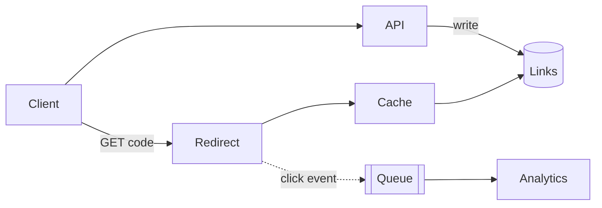

# Case studies: expert

🌐 [Русский](expert.ru.md) · **English**

**Levels:** [overview](overview.en.md) · [1. Basics](basics.en.md) · [2. Advanced](advanced.en.md) · **3. Expert** · [4. Quiz](quiz.en.md)

## Under the hood

Collisions of random codes happen far earlier than the space is exhausted (the birthday paradox): out of 3.5·10¹² variants, a million random codes already give about a 13% chance of at least one collision.



## Reference

| Problem | Main bottleneck | Techniques |
|---|---|---|
| Shortener | reads of hot links | cache, CDN, sharding by code |
| Feed | fan-out of popular authors | hybrid, queues, a bounded feed length |
| Notifications | slow providers | a queue per channel, bulkhead, retries |
| Chat | delivery and order within a dialog | partition by dialog, message numbers |
| Rate limiter | a shared counter | atomic operations, local quotas |

| Deep dive question | |
|---|---|
| What if the cache is lost? | |
| How do you delete a user's data? | |
| What happens at 10x growth? | |
| Where are duplicates possible? | |

## Gotchas

### An identifier does not fit into a double

```csharp
long id = (1L << 53) + 1;
Console.WriteLine(id);
Console.WriteLine((long)(double)id);
```

Result: `9007199254740993` and `9007199254740992`. Clients that read JSON numbers as doubles (JavaScript in particular) will distort large identifiers; send them as strings.

### Ordinary Base64 does not suit a path

```csharp
Console.WriteLine(Convert.ToBase64String([251, 255, 254]));
```

Result: `+//+` — the characters `/` and `+` break a URL. Use base62 or Base64Url.

### The case of a code matters

Base62 distinguishes `aB` from `Ab`. A case-insensitive comparison (a collection with `OrdinalIgnoreCase` or a database with such a collation) would merge different links.

## Trade-offs and alternatives

| Choice | Pro | Con |
|---|---|---|
| Fan-out on write | fast reads | expensive popular authors |
| Fan-out on read | cheap writes | heavy reads |
| Sequential codes | no collisions | others' links can be enumerated |
| Random codes | hard to guess | uniqueness check |
| Synchronous sending | simplicity | dependency on the provider |

## Interview questions

**1. Why base62?**

<details><summary>Answer</summary>

Digits and letters of both cases are URL safe and give a short form.

</details>

**2. How many characters are needed?**

<details><summary>Answer</summary>

Enough for 62ⁿ to cover the expected number of links with a margin.

</details>

**3. How do you avoid collisions of random codes?**

<details><summary>Answer</summary>

A unique constraint and regeneration on conflict.

</details>

**4. How do you serve a popular link?**

<details><summary>Answer</summary>

In-memory cache and CDN, stampede protection.

</details>

**5. What about a celebrity's post?**

<details><summary>Answer</summary>

Do not copy it to everyone, mix it in at read time.

</details>

**6. How do you delete a post from feeds?**

<details><summary>Answer</summary>

Mark it deleted and filter on read; clean up copies in the background.

</details>

**7. How do you avoid sending a notification twice?**

<details><summary>Answer</summary>

An event identifier and deduplication, idempotency at the provider; without it there is no full guarantee after a timeout.

</details>

**8. One slow channel slows everything. What do you do?**

<details><summary>Answer</summary>

Separate queues and workers per channel.

</details>

**9. What is wrong with sequential codes?**

<details><summary>Answer</summary>

They can be enumerated and reveal the business volume.

</details>

**10. Trick question: the interviewer asks for "a billion users". Where do you start?**

<details><summary>Answer</summary>

By clarifying activity and operations: the number of registered users alone does not define the load.

</details>

## Related materials

- [Advanced theory](advanced.en.md)
- [Quiz](quiz.en.md) and [exercises](exercises.en.md)

## Sources

- [RFC 9110: redirection codes](https://www.rfc-editor.org/rfc/rfc9110)
