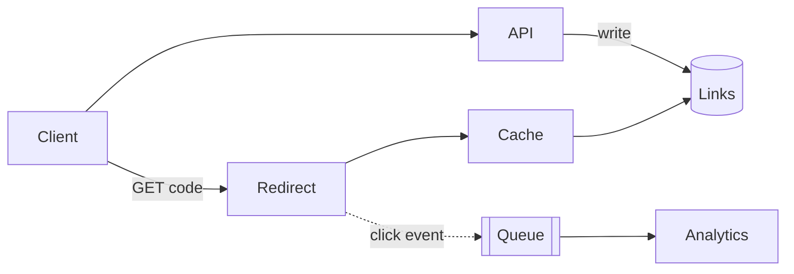

# Разбор задач: экспертная теория

🌐 **Русский** · [English](expert.en.md)

**Уровни:** [обзор](overview.ru.md) · [1. Базовая](basics.ru.md) · [2. Продвинутая](advanced.ru.md) · **3. Экспертная** · [4. Квиз](quiz.ru.md)

## Под капотом

Коллизии случайных кодов наступают гораздо раньше исчерпания пространства (парадокс дней рождения): из 3,5·10¹² вариантов миллион случайных кодов уже даёт вероятность хотя бы одной коллизии около 13%.



### Распределённый rate limiter

Лимит общий для всех экземпляров, значит счётчик живёт в общем хранилище, а «проверить и списать» должно быть одним атомарным действием. В Redis это Lua-скрипт: он выполняется атомарно, но на это время блокирует сервер, поэтому должен быть коротким.

```csharp
tokens = Math.Min(capacity, tokens + (now - at).TotalSeconds * perSecond);

bool allowed = tokens >= 1;
```

Нужно решить, что делать при недоступности хранилища: пропускать или отклонять. Файл: [Ex04_MoreCases.cs](code/Examples/Ex04_MoreCases.cs).

### Чат

Порядок задают номером внутри диалога (не общими часами), повторную отправку распознают по идентификатору клиента, офлайн-клиент просит всё после последнего номера.

```csharp
public IReadOnlyList<string> After(long number) => _messages[(int)number..];
```

Дальше: партиция по диалогу, постоянные соединения и отдельный сервис, знающий, к какому узлу подключён получатель.

### Автодополнение

Для каждого префикса заранее хранят лучшие варианты: чтение — один поиск по ключу, а обновление частот пересчитывает индекс пакетно.

### Файловое хранилище

Файл делят на части, адресуемые по хэшу содержимого: загрузку можно продолжить, одинаковые части хранятся один раз, а метаданные содержат список частей. В тесте вставка одного байта в начало сдвигает все границы, и ни одна часть не совпадает; против этого применяют части переменной длины по содержимому.

### Платёжная система

Записи только добавляются и всегда парами: списание и зачисление в сумме дают ноль; операция имеет идентификатор и применяется один раз; деньги хранят целыми минимальными единицами.

```csharp
if (!_transfers.Add(transferId)) return false;

_entries.Add((from, -cents));
_entries.Add((to, cents));
```

Внешний провайдер может не ответить: нужны состояние «неизвестно», сверка и идемпотентный повтор.

### Геопоиск

Geohash превращает координаты в строку, где общий префикс обычно означает близость, и поиск соседей сводится к поиску по префиксу. Код проверен на примере `57.64911, 10.40744` → `u4pruydqqvj`. Файл: [Ex05_Geohash.cs](code/Examples/Ex05_Geohash.cs).

## Справочник

| Задача | Главное узкое место | Приёмы |
|---|---|---|
| Сокращатель | чтения горячих ссылок | кэш, CDN, шардирование по коду |
| Лента | fan-out популярных авторов | гибрид, очереди, ограничение длины ленты |
| Уведомления | медленные провайдеры | очереди на канал, bulkhead, повторы |
| Чат | доставка и порядок в диалоге | партиция по диалогу, номера сообщений |
| Rate limiter | общий счётчик | атомарные операции, локальные квоты |

| Вопрос на углублении | |
|---|---|
| Что при потере кэша? | |
| Как удалить данные пользователя? | |
| Что будет при росте в 10 раз? | |
| Где возможны дубли? | |

| Задача | Ключ партиции | Главный инвариант |
|---|---|---|
| Rate limiter | клиент | проверка и списание атомарны |
| Чат | диалог | порядок внутри диалога |
| Автодополнение | префикс | быстрое чтение, обновление пакетами |
| Файлы | хэш части | целостность и дедупликация |
| Платежи | счёт | сумма проводок равна нулю |
| Геопоиск | ячейка | смотреть и соседние ячейки |

## Подвохи

### Идентификатор не помещается в double

```csharp
long id = (1L << 53) + 1;
Console.WriteLine(id);
Console.WriteLine((long)(double)id);
```

Результат: `9007199254740993` и `9007199254740992`. Клиенты, читающие числа JSON как double (в частности JavaScript), исказят большие идентификаторы; передавайте их строкой.

### Обычный Base64 не годится для пути

```csharp
Console.WriteLine(Convert.ToBase64String([251, 255, 254]));
```

Результат: `+//+` — символы `/` и `+` ломают URL. Используют base62 или Base64Url.

### Регистр кода имеет значение

Base62 различает `aB` и `Ab`. Сравнение без учёта регистра (в коллекции с `OrdinalIgnoreCase` или в базе с таким collation) склеит разные ссылки.

### Соседи с разными префиксами

Точки `(10, -0.0001)` и `(10, 0.0001)` разделяют десятки метров, но их geohash различаются уже в первом символе. Всегда проверяют соседние ячейки и считают настоящее расстояние.

### Один байт ломает дедупликацию частей

В тесте после вставки символа в начало добавились три новые части из трёх.

## Компромиссы и альтернативы

| Выбор | Плюс | Минус |
|---|---|---|
| Fan-out при записи | быстрое чтение | дорогие популярные авторы |
| Fan-out при чтении | дешёвая запись | тяжёлое чтение |
| Последовательные коды | без коллизий | можно перебрать чужие ссылки |
| Случайные коды | трудно угадать | проверка уникальности |
| Синхронная отправка | простота | зависимость от провайдера |

## Вопросы с собеседований

**1. Почему base62?**

<details><summary>Ответ</summary>

Цифры и буквы двух регистров безопасны в URL и дают короткую запись.

</details>

**2. Сколько символов нужно?**

<details><summary>Ответ</summary>

Столько, чтобы 62ⁿ с запасом покрывало ожидаемое число ссылок.

</details>

**3. Как избежать коллизий случайных кодов?**

<details><summary>Ответ</summary>

Уникальное ограничение и повтор генерации при конфликте.

</details>

**4. Как обслужить популярную ссылку?**

<details><summary>Ответ</summary>

Кэш в памяти и CDN, защита от stampede.

</details>

**5. Что делать с постом звезды?**

<details><summary>Ответ</summary>

Не копировать всем, а подмешивать при чтении.

</details>

**6. Как удалить пост из ленты?**

<details><summary>Ответ</summary>

Отметить удалённым и фильтровать при чтении; копии чистить фоном.

</details>

**7. Как не отправить уведомление дважды?**

<details><summary>Ответ</summary>

Идентификатор события и дедупликация, идемпотентность у провайдера; полной гарантии при таймауте без неё нет.

</details>

**8. Один медленный канал тормозит все. Что делать?**

<details><summary>Ответ</summary>

Отдельные очереди и воркеры на канал.

</details>

**9. Чем плохи последовательные коды?**

<details><summary>Ответ</summary>

Их можно перебрать и узнать объём бизнеса.

</details>

**10. Подвох: интервьюер просит «на миллиард пользователей». С чего начать?**

<details><summary>Ответ</summary>

С уточнения активности и операций: число зарегистрированных само по себе не задаёт нагрузку.

</details>

**11. Как сделать лимит общим для нескольких экземпляров?**

<details><summary>Ответ</summary>

Общее хранилище с атомарной проверкой и списанием, либо локальные квоты с периодической синхронизацией.

</details>

**12. Как упорядочить сообщения чата?**

<details><summary>Ответ</summary>

Номером внутри диалога, выдаваемым одним владельцем партиции.

</details>

**13. Почему нельзя хранить деньги в `double`?**

<details><summary>Ответ</summary>

Двоичная дробь не представляет десятичные суммы точно; берут целые минимальные единицы или `decimal`.

</details>

**14. Как найти объекты рядом по geohash?**

<details><summary>Ответ</summary>

Искать в своей и соседних ячейках, затем отфильтровать по расстоянию.

</details>

**15. Подвох: баланс хранят отдельным полем и обновляют при переводах. Что может пойти не так?**

<details><summary>Ответ</summary>

Он может разойтись с проводками при конкуренции или повторах; нужны атомарность и сверка с журналом.

</details>

## Связанные материалы

- [Продвинутая теория](advanced.ru.md)
- [Квиз](quiz.ru.md) и [упражнения](exercises.ru.md)

## Источники

- [RFC 9110: коды перенаправления](https://www.rfc-editor.org/rfc/rfc9110)
- [Redis: Lua-скрипты](https://redis.io/docs/latest/develop/programmability/eval-intro/)
- [Geohash](https://en.wikipedia.org/wiki/Geohash)
