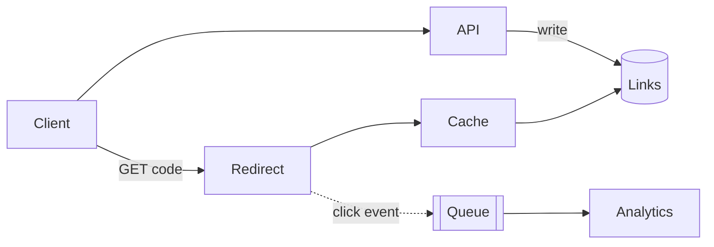

# Разбор задач: экспертная теория

🌐 **Русский** · [English](expert.en.md)

**Уровни:** [обзор](overview.ru.md) · [1. Базовая](basics.ru.md) · [2. Продвинутая](advanced.ru.md) · **3. Экспертная** · [4. Квиз](quiz.ru.md)

## Под капотом

Коллизии случайных кодов наступают гораздо раньше исчерпания пространства (парадокс дней рождения): из 3,5·10¹² вариантов миллион случайных кодов уже даёт вероятность хотя бы одной коллизии около 13%.



## Справочник

| Задача | Главное узкое место | Приёмы |
|---|---|---|
| Сокращатель | чтения горячих ссылок | кэш, CDN, шардирование по коду |
| Лента | fan-out популярных авторов | гибрид, очереди, ограничение длины ленты |
| Уведомления | медленные провайдеры | очереди на канал, bulkhead, повторы |
| Чат | доставка и порядок в диалоге | партиция по диалогу, номера сообщений |
| Rate limiter | общий счётчик | атомарные операции, локальные квоты |

| Вопрос на углублении | |
|---|---|
| Что при потере кэша? | |
| Как удалить данные пользователя? | |
| Что будет при росте в 10 раз? | |
| Где возможны дубли? | |

## Подвохи

### Идентификатор не помещается в double

```csharp
long id = (1L << 53) + 1;
Console.WriteLine(id);
Console.WriteLine((long)(double)id);
```

Результат: `9007199254740993` и `9007199254740992`. Клиенты, читающие числа JSON как double (в частности JavaScript), исказят большие идентификаторы; передавайте их строкой.

### Обычный Base64 не годится для пути

```csharp
Console.WriteLine(Convert.ToBase64String([251, 255, 254]));
```

Результат: `+//+` — символы `/` и `+` ломают URL. Используют base62 или Base64Url.

### Регистр кода имеет значение

Base62 различает `aB` и `Ab`. Сравнение без учёта регистра (в коллекции с `OrdinalIgnoreCase` или в базе с таким collation) склеит разные ссылки.

## Компромиссы и альтернативы

| Выбор | Плюс | Минус |
|---|---|---|
| Fan-out при записи | быстрое чтение | дорогие популярные авторы |
| Fan-out при чтении | дешёвая запись | тяжёлое чтение |
| Последовательные коды | без коллизий | можно перебрать чужие ссылки |
| Случайные коды | трудно угадать | проверка уникальности |
| Синхронная отправка | простота | зависимость от провайдера |

## Вопросы с собеседований

**1. Почему base62?**

<details><summary>Ответ</summary>

Цифры и буквы двух регистров безопасны в URL и дают короткую запись.

</details>

**2. Сколько символов нужно?**

<details><summary>Ответ</summary>

Столько, чтобы 62ⁿ с запасом покрывало ожидаемое число ссылок.

</details>

**3. Как избежать коллизий случайных кодов?**

<details><summary>Ответ</summary>

Уникальное ограничение и повтор генерации при конфликте.

</details>

**4. Как обслужить популярную ссылку?**

<details><summary>Ответ</summary>

Кэш в памяти и CDN, защита от stampede.

</details>

**5. Что делать с постом звезды?**

<details><summary>Ответ</summary>

Не копировать всем, а подмешивать при чтении.

</details>

**6. Как удалить пост из ленты?**

<details><summary>Ответ</summary>

Отметить удалённым и фильтровать при чтении; копии чистить фоном.

</details>

**7. Как не отправить уведомление дважды?**

<details><summary>Ответ</summary>

Идентификатор события и дедупликация, идемпотентность у провайдера; полной гарантии при таймауте без неё нет.

</details>

**8. Один медленный канал тормозит все. Что делать?**

<details><summary>Ответ</summary>

Отдельные очереди и воркеры на канал.

</details>

**9. Чем плохи последовательные коды?**

<details><summary>Ответ</summary>

Их можно перебрать и узнать объём бизнеса.

</details>

**10. Подвох: интервьюер просит «на миллиард пользователей». С чего начать?**

<details><summary>Ответ</summary>

С уточнения активности и операций: число зарегистрированных само по себе не задаёт нагрузку.

</details>

## Связанные материалы

- [Продвинутая теория](advanced.ru.md)
- [Квиз](quiz.ru.md) и [упражнения](exercises.ru.md)

## Источники

- [RFC 9110: коды перенаправления](https://www.rfc-editor.org/rfc/rfc9110)
